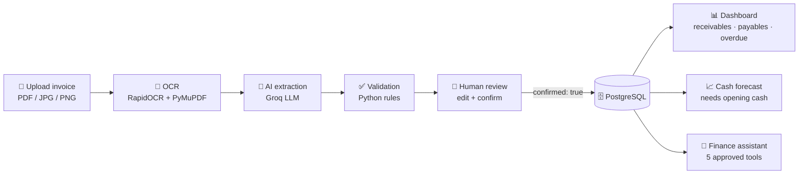
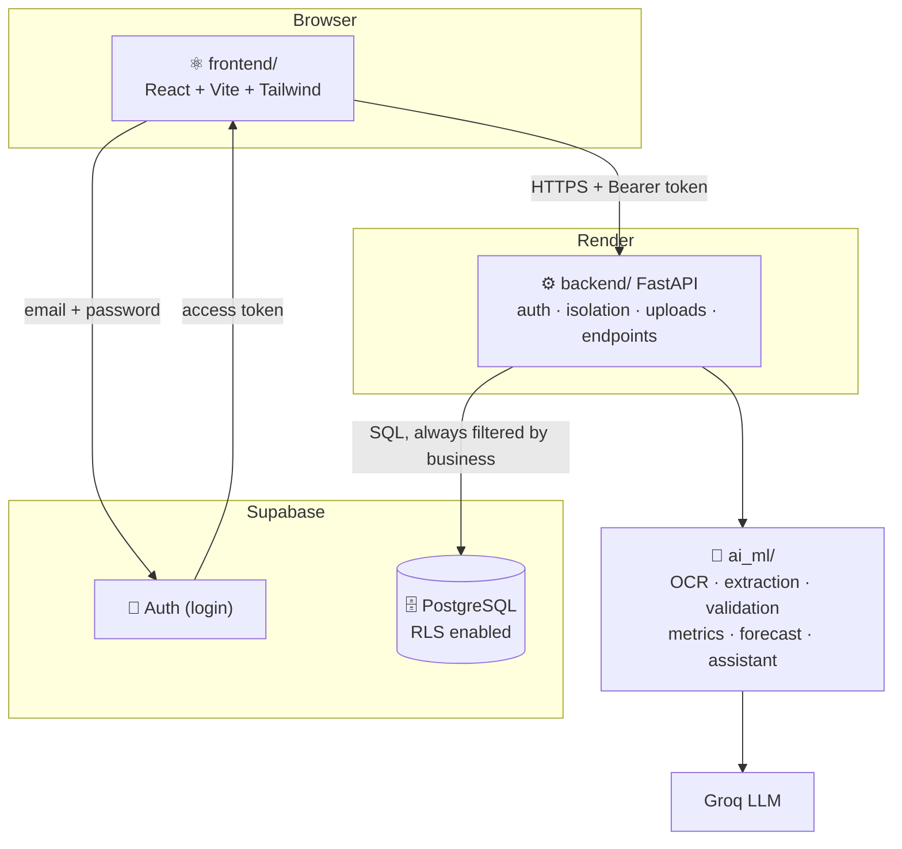

# 💼 BizFlow AI: AI-Powered Finance Assistant for Small Businesses

[](https://bizflow-backend-2onh.onrender.com/docs)
[](https://github.com/mrrohan4321/BizFlowAI)
[](https://biz-flow-ai-xi.vercel.app/)
[](https://youtu.be/Tf-raKI9BRM)


**Team Finnovate · Arthaton 2026** · Upload an invoice, let **OCR + AI** read it, **review and confirm** it, then track payments, expenses, overdue invoices, monthly performance and a **cash-flow estimate**, and ask questions about your money in plain language.

> 💡 **Core principle:** AI helps with *understanding* (OCR, field extraction, explaining answers). **Python does every financial calculation.** The LLM never does arithmetic and never writes SQL.
>
> ⚠️ This is a hackathon project. Forecasts are **estimates**, not financial advice or a guarantee.

---

## 🌐 Live Application

| 🔗 Resource | Link |
|---|---|
| 🌍 Live web app (frontend) | [biz-flow-ai-xi.vercel.app](https://biz-flow-ai-xi.vercel.app/) |
| ⚙️ Live API / Swagger | [bizflow-backend-2onh.onrender.com/docs](https://bizflow-backend-2onh.onrender.com/docs) |
| ❤️ API health check | [/api/health](https://bizflow-backend-2onh.onrender.com/api/health) |
| 🎬 Demo video | [Watch on YouTube](https://youtu.be/Tf-raKI9BRM) |
| 🗂️ Repository | [github.com/mrrohan4321/BizFlowAI](https://github.com/mrrohan4321/BizFlowAI) |

The backend runs on Render's free plan: it **sleeps when unused**, so the first request can take about a minute. If a page seems stuck, wait and retry.

---

## 🌟 Key Features

1. **Invoice OCR + AI Extraction**
   - Upload a PDF, JPG or PNG. OCR reads the text, an LLM (Groq) turns it into structured fields (number, party, dates, subtotal, GST, total).
   - Deterministic validation flags wrong totals, GST mismatches, bad GSTIN and date problems.

2. **Human-in-the-Loop Review**
   - Extracted data is **never saved automatically**. The user edits it in a review form and presses **Confirm**.
   - Invoices with warnings are saved as `needs_review` and stay visible as such.

3. **Receivables, Payables and Overdue**
   - Receivables (customers owe you) and payables (you owe suppliers) are always separate.
   - Partial and multiple payments per invoice; overpayment is blocked.

4. **Cash-Flow Forecast You Can Explain**
   - Moving-average baseline from **actual cash only** (payments received/paid and expenses marked paid).
   - Needs a real **opening cash balance**. Without it the API answers `409`; zero is never assumed.
   - Every forecast shows assumptions, warnings and a disclaimer.

5. **Grounded Finance Assistant**
   - Ask "How much do my customers owe me?", "Which invoices are overdue?", "What is my expected cash flow?".
   - The LLM only **picks one of 5 approved Python tools** and explains the calculated result.

6. **Secure by Design**
   - Supabase login (JWT). The server decides which business you can see; the frontend never sends a `business_id`.
   - Every SQL query is filtered by business, Row Level Security is on, uploads are checked (type, content, size), and errors never leak internals.

---

## 🔄 Pipeline



### 🏗️ Architecture



The browser uses Supabase **only for login**. All business data flows through the backend, and only the logged-in business's records ever reach `ai_ml` (and Groq).

---

## 📈 Results at a Glance

### 🧪 Known-answer demo (seeded business "Sen Electricals")

| Check | Expected value |
|---|---|
| Receivables (INV-102 30,000 + INV-103 15,000 left) | **45,000** |
| Payables (PUR-201) | **20,000** |
| After recording a 10,000 payment on INV-102 | receivables **35,000** |
| Overdue invoice | INV-102 (due 2026-11-10) |
| Opening cash | 150,000 on 2026-10-31 |

Full seed description: [`database/README.md`](database/README.md).

### 🧱 What is built

| Layer | Delivered |
|---|---|
| AI/ML | OCR, extraction, validation, finance metrics, forecast, assistant with 5 tools, unit tests with mocked Groq |
| Backend | 20+ endpoints, Supabase JWT auth, business isolation, safe uploads, payments/expenses/opening cash, analytics, assistant, pytest suite, Render deployment |
| Database | schema + 2 migrations, Row Level Security, synthetic demo seed |
| Frontend | 8 screens: login, overview, upload and review, invoices, invoice detail, expenses, cash flow, assistant; light and night theme |

### 🔍 Key Takeaways

- Money rules live in **one place** (`ai_ml/`), so the frontend, API and LLM can never disagree.
- Nothing AI-extracted reaches the database without an explicit human confirmation.
- Unpaid invoices and unpaid expenses are **never counted as cash**, so the forecast stays honest.

### 🎬 Demo Video

[](https://youtu.be/Tf-raKI9BRM)

▶️ [Watch the full walkthrough on YouTube](https://youtu.be/Tf-raKI9BRM). The script is in [Demo Script](#-demo-video-script) below.

---

## 📁 Project Structure

```
BizFlowAI/
├── README.md                    # You are here
├── API-notes.md                 # Shared API contract (endpoints + money rules)
├── .env.example                 # Names of backend environment variables (no secrets)
├── render.yaml                  # Render deployment blueprint for the backend
├── backend/                     # FastAPI app                          -> backend/README.md
│   ├── app/                     # main, auth, config, errors, routes/, services/, schemas/, db/
│   ├── tests/                   # pytest suite (needs a Postgres URL)  -> backend/tests/README.md
│   └── scripts/                 # smoke_test.py for a running server   -> backend/scripts/README.md
├── ai_ml/                       # AI/ML module                         -> ai_ml/README.md
│   ├── BACKEND_CLAUDE_HANDOFF.md
│   └── tests/                   # pytest suite, Groq mocked            -> ai_ml/tests/README.md
├── database/                    # schema.sql, migrations/, seed_demo.sql -> database/README.md
├── frontend/                    # React app                            -> frontend/README.md
│   ├── FRONTEND_CLAUDE_HANDOFF.md
│   └── src/                     # pages/, components/, services/
└── sample_data/                 # Synthetic invoices only              -> sample_data/README.md
```

---

## 🛠️ Quick Start (Local Setup)

Requirements: **Python 3.12**, **Node.js 20.19+** (or 22.12+), a free **Supabase** project, a **Groq** API key (only for extraction and the assistant).

### 1. Clone the Repository
```bash
git clone https://github.com/mrrohan4321/BizFlowAI.git
cd BizFlowAI
```

### 2. Start the Backend
```bash
cd backend
python -m venv .venv && source .venv/bin/activate     # Windows: .venv\Scripts\activate
pip install -r requirements.txt
cp ../.env.example ../.env       # fill DATABASE_URL, SUPABASE_URL (+ SUPABASE_JWT_SECRET for HS256 projects), GROQ_API_KEY
python -m app.db.migrate         # creates the tables
uvicorn app.main:app --reload    # API docs: http://localhost:8000/docs
```
The backend `.env` lives in the **repo root**, not in `backend/`.

### 3. (Optional) Load the Demo Data
Create a user in Supabase (Authentication → Users), put its **User UID** into `demo_user` in `database/seed_demo.sql`, and run the file in the Supabase SQL Editor.

### 4. Start the Frontend
```bash
cd frontend
npm install
cp .env.example .env             # VITE_API_URL, VITE_SUPABASE_URL, VITE_SUPABASE_ANON_KEY
npm run dev                      # http://localhost:5173
```
You can skip step 2 and use the deployed backend: `VITE_API_URL=https://bizflow-backend-2onh.onrender.com`.

<details>
<summary><b>🔑 Getting a token for Swagger (/docs → Authorize)</b></summary>

```bash
curl -X POST "$SUPABASE_URL/auth/v1/token?grant_type=password" -H "apikey: <anon key>" \
  -H "Content-Type: application/json" -d '{"email":"you@example.com","password":"..."}'
```
Paste the `access_token` into **Authorize**. A new user also needs a row in `business_members` (the demo seed creates it), otherwise every endpoint returns `403 no_business_access`.
</details>

---

## 🎥 Demo Video Script

▶️ **Video:** [https://youtu.be/Tf-raKI9BRM](https://youtu.be/Tf-raKI9BRM)

The demo showcases the core workflow of BizFlow AI:

1. **Invoice Upload:** Upload a sample invoice (**INV-67 – ABC Constructions**) to the platform.
2. **Invoice Processing:** Demonstrate how BizFlow AI processes the uploaded invoice (OCR → AI extraction → validation → human review and **Confirm**) and stores its information.
3. **AI Financial Assistant:** Interact with the AI-powered assistant by asking business-related financial questions (for example "How much do my customers owe me?", "Which invoices are overdue?", "What is my expected cash flow?") and viewing its responses.
4. **Invoice Management:** Delete the uploaded sample invoice after completing the demonstration.

The demonstration highlights BizFlow AI's invoice management capabilities and its AI-powered financial assistant, bringing business financial operations and intelligent insights together in one platform.

> 🔁 **Want to repeat it yourself?** Log in to the [live app](https://biz-flow-ai-xi.vercel.app/) (or your local copy with the demo seed), go to **Upload**, choose a sample invoice from [`sample_data/invoices/`](sample_data/invoices/), review the fields and press **Confirm & save**. Then open the **Assistant** page and ask a question. Finally open the invoice in **Invoices** and delete it (only possible while it has no payments).

---

## 📏 Money Rules (kept by the whole team)

1. **Nothing AI-extracted is saved without the user pressing confirm** (`confirmed: true`).
2. **Receivables** = outstanding *sales* invoices. **Payables** = outstanding *purchase* invoices. Never added together.
3. **Cash** = actual payments only. Unpaid invoices and unpaid expenses are never cash.
4. A cost is recorded as a purchase invoice **or** an expense, never both (double counting).
5. The business is resolved **on the server** from the logged-in user.
6. The forecast needs an opening cash balance (month-end date), else `409 opening_cash_required`.
7. Forecast and `operating_surplus_estimate` are **estimates** and always labelled so.

---

## 🤖 AI Models & APIs Used

| Component | Model / API | What it does here | Where |
|---|---|---|---|
| **LLM** | **Groq API** (OpenAI-compatible chat completions) running **`openai/gpt-oss-120b`** (override with `GROQ_MODEL`) | (1) turns raw invoice text into structured JSON fields; (2) picks **one** of 5 approved finance tools for a question; (3) writes a plain-language answer from the already-calculated result. `temperature=0`, JSON output mode for extraction and tool choice, 30 s timeout. | `ai_ml/invoice_extraction.py`, `ai_ml/assistant.py` |
| **OCR** | **RapidOCR** (open-source, ONNX models, runs locally on the server) | Reads text from JPG / PNG invoices and scanned PDFs. | `ai_ml/ocr.py` |
| **PDF text** | **PyMuPDF** | Reads text directly from digital PDFs (OCR is used only when a page has too little text). | `ai_ml/ocr.py` |
| **Forecast** | Plain Python (moving average, `Decimal` maths), **no ML model or API** | Cash-flow estimate from actual payments and paid expenses. | `ai_ml/forecasting.py` |
| **Auth + Database** | **Supabase** Auth (JWT) and PostgreSQL | Login and data storage with Row Level Security. | `backend/`, `database/` |

**Guard-rails:** the LLM never calculates money and never writes SQL. All totals, receivables, overdue lists and forecasts come from deterministic Python in `ai_ml/finance_metrics.py` and `ai_ml/forecasting.py`; the LLM only reads text and explains results. Only the logged-in business's data is sent to Groq.

**API keys needed to run it:** only a free **Groq API key** (`GROQ_API_KEY`) plus a **Supabase** project. RapidOCR and PyMuPDF need no key.

---

## 🧰 Tech Stack

| Layer | Technology |
|---|---|
| 🖥️ Frontend | React 19, Vite 7, Tailwind CSS 4, React Router 7, Recharts 3, Axios, lucide-react, Supabase JS (login only) |
| ⚙️ Backend | FastAPI, Pydantic v2, psycopg2 (raw SQL, no ORM), PyJWT |
| 🗄️ Database / Auth | Supabase PostgreSQL + Auth, Row Level Security |
| 🧠 AI/ML | RapidOCR + PyMuPDF, Groq LLM (`openai/gpt-oss-120b`), Decimal-based finance maths, moving-average forecast |
| ☁️ Hosting | Render (backend, `render.yaml`) · static hosting for the frontend (`frontend/vercel.json`) |

---

## 🧪 Tests

```bash
# backend: runs inside a throw-away Postgres schema, real data is never touched
cd backend && TEST_DATABASE_URL=postgresql://... python -m pytest tests -v

# ai_ml: from the repo root, no database or API key needed (Groq is mocked)
python -m pytest ai_ml/tests -v

# frontend
cd frontend && npm run build
```

Run them before every merge. Details: [`backend/tests/README.md`](backend/tests/README.md) · [`ai_ml/tests/README.md`](ai_ml/tests/README.md).
The frontend has no automated tests yet; `npm run build` plus the [demo script](#-demo-video-script) is the check.

---

## 🚀 Deployment & Environment

| Part | Where | Notes |
|---|---|---|
| Backend | Render via [`render.yaml`](render.yaml) | start command runs migrations, then Uvicorn; health check `/api/health` |
| Frontend | Vercel ([live](https://biz-flow-ai-xi.vercel.app/)) | set the 3 `VITE_` variables, keep the "all paths → `/index.html`" rewrite (`frontend/vercel.json`) |
| Database / Auth | Supabase | use the connection **pooler** string for `DATABASE_URL` on Render |

The frontend's HTTPS URL (`https://biz-flow-ai-xi.vercel.app`, no trailing slash) must be in `ALLOWED_ORIGINS` on Render (comma-separated, for example `http://localhost:5173,https://biz-flow-ai-xi.vercel.app`), otherwise the browser blocks every call (CORS). Check a deployment with `python backend/scripts/smoke_test.py`.

Environment variables: [`.env.example`](.env.example) · [`backend/README.md`](backend/README.md#-environment-variables) · [`frontend/README.md`](frontend/README.md). **Never commit `.env`**, the database password, the JWT secret or the Groq key.

🔒 **Privacy:** invoice text is sent to **Groq** (a third-party AI service) for extraction, and assistant questions plus the calculated result are sent to Groq to write the answer. Use synthetic data for demos. Never commit real invoices (`sample_data/real/` and `uploads/` are git-ignored).

---

## ⚠️ Limitations

- **No sign-up / "create my business" endpoint:** a new Supabase user gets `403 no_business_access` until a `business_members` row is inserted (the seed does it for the demo user).
- **Uploaded invoice files** cannot be downloaded again and vanish on Render restart (the extracted data stays in the database).
- **Assistant scope:** only 5 tools (receivables, payables, overdue, monthly performance, cash forecast); no expense-specific questions yet.
- **Forecast is a baseline:** a moving average of recorded history; it cannot invent missing months and is not a guarantee.
- **OCR quality varies:** blurry scans may need manual correction at review (that is why review is mandatory).
- **Free hosting:** cold start of about a minute and 512 MB RAM (very large images can fail OCR).
- **Frontend:** no automated tests yet; manual verification is tracked in [`frontend/README.md`](frontend/README.md#-8-verification-checklist).

---

## 👥 Team (Finnovate)

| Member | Role | Name | Owns |
|---|---|---|---|
| 1 | Frontend | Ronit Jana | `frontend/` |
| 2 | Backend, Database, Deployment | Rohan Adak | `backend/`, `database/`, `render.yaml` |
| 3 | AI / ML | Rajdeep Panja | `ai_ml/` |

`sample_data/` and `API-notes.md` are shared.

### ✅ Status

| Stage | Status |
|---|---|
| AI/ML module + tests | ✅ Done |
| Backend API + tests + Render deployment | ✅ Done |
| Database schema, migrations, RLS, demo seed | ✅ Done |
| Frontend (8 screens) | ✅ Done |
| Live frontend URL | ✅ Done ([Vercel](https://biz-flow-ai-xi.vercel.app/)) |
| Demo video | ✅ Done ([YouTube](https://youtu.be/Tf-raKI9BRM)) |
| Demo script in README | ✅ Done |

### 📏 Team Rules

- `API-notes.md` is the shared contract. **Agree before changing an endpoint**, then update `API-notes.md`, `backend/README.md`, the frontend service layer and the tests together.
- Each folder has its own README. If you change a folder, update its README in the same commit.
- Do not move financial calculations into the frontend or the LLM prompts. They belong to `ai_ml/`.
- Only synthetic data goes in `sample_data/`. Never commit secrets or real invoices.

---

## 📚 References

- [FastAPI](https://fastapi.tiangolo.com/) · [Pydantic](https://docs.pydantic.dev/) · [Supabase](https://supabase.com/docs) · [Groq](https://console.groq.com/docs)
- [RapidOCR](https://github.com/RapidAI/RapidOCR) · [PyMuPDF](https://pymupdf.readthedocs.io/)
- [React](https://react.dev/) · [Vite](https://vite.dev/) · [Tailwind CSS](https://tailwindcss.com/) · [Recharts](https://recharts.org/)
